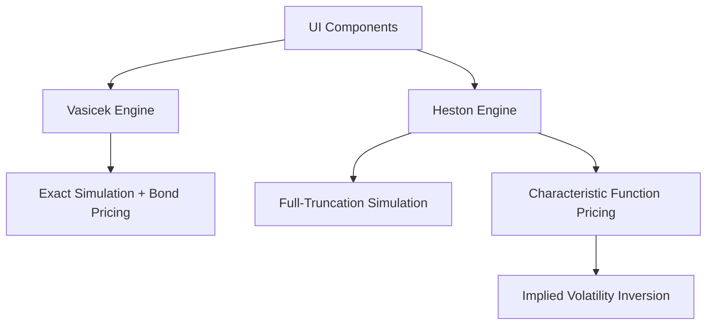

# STOCHLAB — Exploring the Mathematics of Financial Uncertainty

An interactive computational laboratory for stochastic interest rates (Vasicek) and stochastic volatility (Heston).

**Live site:** https://PrakharQuant.github.io/stochlab/

Built by [Prakhar Gupta](https://github.com/PrakharQuant)

## Overview

Financial markets are driven by uncertainty. STOCHLAB lets you:

- Simulate mean-reverting interest rates with the exact Vasicek transition
- Explore Heston stock and variance paths with correlated Brownian motions
- Price European options via the Heston characteristic function
- Observe how correlation and vol-of-vol generate implied-volatility skew and smile
- Compare analytical moments with Monte Carlo sample statistics

This is a research and educational tool, not a trading platform.

## Models

### Vasicek (1977)

$$
dr_t = a(b - r_t)\,dt + \sigma\, dW_t
$$

Exact transition and closed-form zero-coupon bond prices via the affine structure.

### Heston (1993)

$$
\begin{aligned}
dS_t &= r S_t\, dt + \sqrt{v_t} S_t\, dW_t^S \\
dv_t &= \kappa(\theta - v_t)\, dt + \xi\sqrt{v_t}\, dW_t^v \\
d\langle W^S, W^v\rangle_t &= \rho\, dt
\end{aligned}
$$

Full-truncation Euler simulation and characteristic-function pricing.

## Technology

- React + TypeScript + Vite
- Plotly.js for interactive charts
- KaTeX for mathematics
- Tailwind CSS
- Vitest for unit tests
- Pure TypeScript implementations (no backend required)

## Local Development

```bash
npm install
npm run dev
npm test
npm run build
```

## Deployment

The site is automatically deployed to GitHub Pages via GitHub Actions on every push to `main`.

## Architecture



## References

- Vasicek, O. (1977). *An Equilibrium Characterization of the Term Structure*. Journal of Financial Economics, 5(2), 177–188.
- Heston, S. L. (1993). *A Closed-Form Solution for Options with Stochastic Volatility with Applications to Bond and Currency Options*. The Review of Financial Studies, 6(2), 327–343.

## Known Limitations

- Heston pricing uses a simple trapezoidal integration; extreme parameters may require more sophisticated quadrature or damping.
- Full-truncation Euler is an approximate scheme; the continuous CIR process is not exactly reproduced.
- The Feller condition is displayed but not enforced.
- No calibration to market data (by design — this is a laboratory, not a production pricing engine).

## Contact

- Email: bestofprakhar@gmail.com
- LinkedIn: [Prakhar Gupta](https://www.linkedin.com/in/prakhar-gupta)
- X / Twitter: [@PrakharQuant](https://twitter.com/PrakharQuant)
- GitHub: [PrakharQuant](https://github.com/PrakharQuant)
